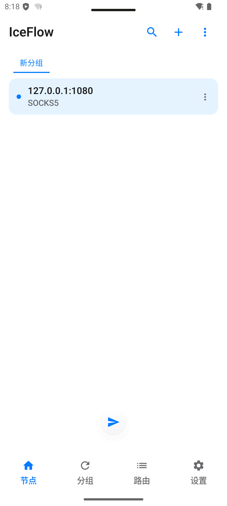
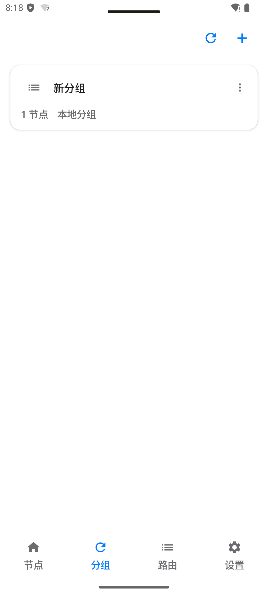
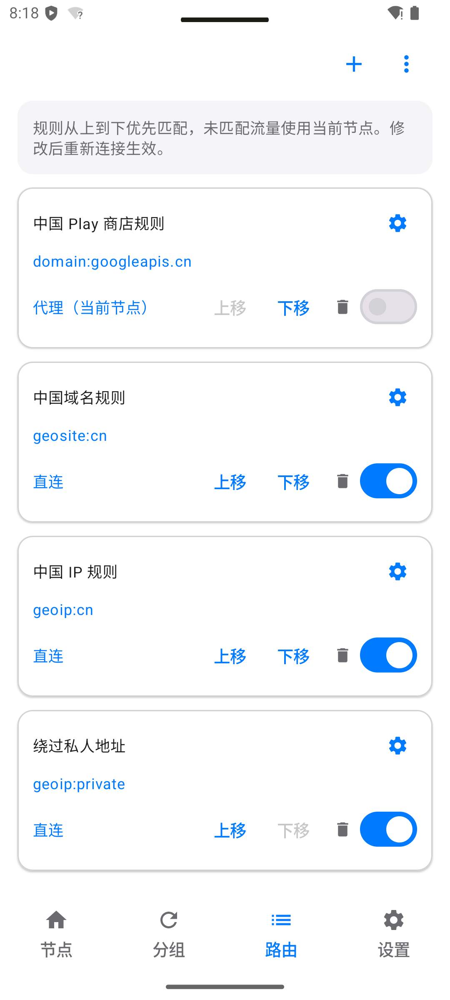
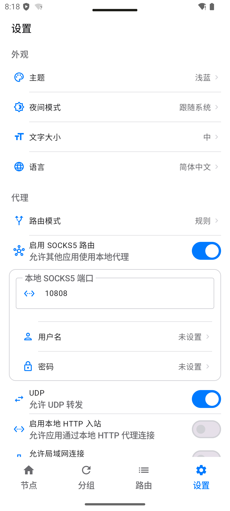
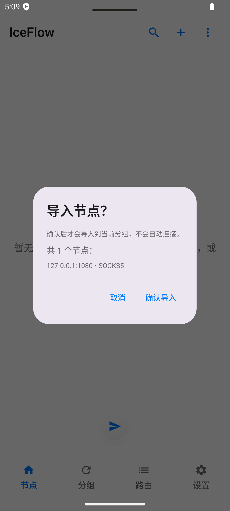
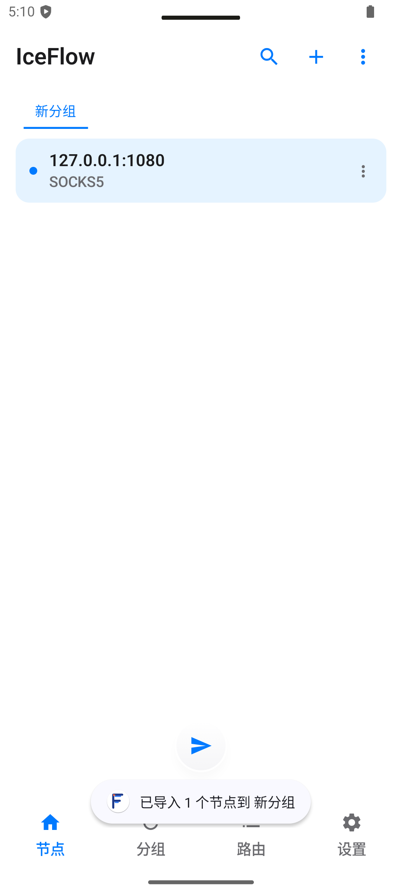

# IceFlow

**A modern Android proxy client · dual and single core variants**

  
  
  
  

[⬇️ Download v0.1.5.1](https://github.com/HlONGlin/IceFlow/releases/latest) · [简体中文](README.md)

---

IceFlow is an Android proxy client built with Jetpack Compose. It combines node and subscription management, rule-based routing, and automatic recovery after network interruptions. The dual and single variants share the same UI, subscription and routing features, with APKs for multiple device architectures.

**Current release** v0.1.5.1 · **versionCode** 113 · **Android** 8.0+

## App Module Preview

These screens were captured while IceFlow single v0.1.5.1 was running on `emulator-5566` (Pixel Tablet, Android 15 / API 35). The gallery focuses on nodes, groups, routing, settings and import. Click any image to open the full emulator capture.

<table>
  <tr>
    <td align="center" width="50%">
      <b>Node Management</b> 
       
      Review node protocols and manage entries in a group.
    </td>
    <td align="center" width="50%">
      <b>Groups</b> 
       
      See local groups and their node counts.
    </td>
  </tr>
  <tr>
    <td align="center" width="50%">
      <b>Rule-Based Routing</b> 
       
      Adjust rule order, match conditions and traffic outlets.
    </td>
    <td align="center" width="50%">
      <b>Proxy Settings</b> 
       
      Theme, night mode, routing mode and local proxy options.
    </td>
  </tr>
</table>

### Import Confirmation

External node imports show a review step first. Confirming adds the entry to the current group without starting a connection.

<table>
  <tr>
    <td align="center" width="50%"><b>Confirm Import</b> </td>
    <td align="center" width="50%"><b>Import Complete</b> </td>
  </tr>
</table>

> `127.0.0.1:1080` in the node list is a local SOCKS5 demo entry, not a public working node. These screenshots show the app UI and do not represent an upstream proxy or real-world throughput.

Network interruption and recovery screens

<table>
  <tr>
    <td align="center" width="33%"> Connected</td>
    <td align="center" width="33%"> Waiting for the network</td>
    <td align="center" width="33%"> Automatic reconnection</td>
  </tr>
</table>

## What's New in v0.1.5.1

- A dedicated waiting state appears when the network drops, hiding stale traffic and speed data.
- IceFlow reconnects automatically when the network returns; users can still disconnect while waiting.
- Both dual and single variants include the recovery behavior and localized strings.

See the [full change log](CHANGELOG-v0.1.5.1.md).

## Downloads

Get signed APKs from [GitHub Release v0.1.5.1](https://github.com/HlONGlin/IceFlow/releases/tag/v0.1.5.1). The existing production signing key is retained, so the APK can update an existing installation while preserving app data.

| Variant | Core | Recommended download | Description |
| --- | --- | --- | --- |
| **single** | mihomo | [Universal APK](https://github.com/HlONGlin/IceFlow/releases/download/v0.1.5.1/IceFlow-0.1.5.1-single-universal-release.apk) | Simple installation for most devices |
| **dual** | xray + mihomo + Rust TUN | [Universal APK](https://github.com/HlONGlin/IceFlow/releases/download/v0.1.5.1/IceFlow-0.1.5.1-dual-universal-release.apk) | For devices that need dual-core features |

`arm64-v8a`, `armeabi-v7a` and `x86_64` packages are also available. Checksums: [SHA256SUMS.txt](https://github.com/HlONGlin/IceFlow/releases/download/v0.1.5.1/SHA256SUMS.txt) · [Build manifest](https://github.com/HlONGlin/IceFlow/releases/download/v0.1.5.1/ARTIFACT_MANIFEST.json)

## Features

| Area | Capabilities |
| --- | --- |
| Protocols | VMess, VLESS with Reality, Trojan, Shadowsocks, Mieru, Hysteria/Hysteria2, TUIC, WireGuard, SSR, HTTP, SOCKS, AnyTLS and Sudoku |
| Import | Clash YAML, QR codes, HTTPS subscriptions, node links, deep links and config files |
| Routing | Rule-based routing, per-app proxy, DNS routing, IPv6, proxy chains and rule-specific outbound selection |
| Management | Node groups, subscription updates, batch import, latency tests, traffic statistics, backup and restore |
| Experience | Material Design 3, dark mode, themes, responsive layout and automatic network recovery |

## Core Variants

- **dual** packages xray, mihomo and the Rust TUN layer.
- **single** packages mihomo only.

Both variants share the app UI, node management, subscriptions and routing. The app clearly reports capabilities that depend on a particular core.

## Connection Flow

~~~mermaid
flowchart TB
    UI["Jetpack Compose UI"] --> VPN["Android VpnService / TUN"]
    VPN --> DUAL["dual · xray + mihomo + Rust TUN"]
    VPN --> SINGLE["single · mihomo"]
    DUAL --> ROUTE["Protocol handling and routing"]
    SINGLE --> ROUTE
    ROUTE --> SERVER["Remote proxy server"]
~~~

## Quick Start

1. Download the APK for your device from [Releases](https://github.com/HlONGlin/IceFlow/releases/latest).
2. Add a node, import an HTTPS subscription, or share a node to IceFlow from another app.
3. Select a node and tap connect. Approve Android's VPN permission on the first connection.
4. If the network drops while connected, wait for it to return; IceFlow reconnects automatically.

## Deep Links and Imports

External imports show a confirmation dialog first. Nothing is written and no connection starts before confirmation.

| Entry point | Example |
| --- | --- |
| Clash subscription | `clash://install-config?url=https%3A%2F%2Fexample.com%2Fsub` |
| IceFlow subscription | `iceflow://install-config?url=https%3A%2F%2Fexample.com%2Fsub&name=My%20Sub` |
| v2rayN subscription | `v2rayn://install-sub?url=https%3A%2F%2Fexample.com%2Fsub` |
| sing-box profile | `sing-box://import-remote-profile?url=https%3A%2F%2Fexample.com%2Fsub` |
| Node links | `vmess://`, `vless://`, `trojan://`, `ss://`, `ssr://`, `hysteria2://`, `hy2://`, `tuic://`, `wireguard://`, `anytls://`, `mierus://` |
| Config files | Open `.yaml`, `.yml`, `.json` or `.txt` from a file manager (4 MiB limit) |

Subscriptions require HTTPS. Duplicate URLs are not added twice. Full `mieru://` Protobuf links require the dual variant.

<b>Build from Source</b>

### Requirements

- JDK 17
- Android SDK 36 and NDK
- Rust with `cargo-ndk`
- Go 1.26+

### Project Structure

| Directory | Purpose |
| --- | --- |
| `app/` | Android app, Compose UI and VPN service |
| `rust-core/` | Rust TUN forwarding layer used by dual |
| `xray-wrapper/` | xray gomobile wrapper used by dual |
| `mihomo-wrapper/` | mihomo gomobile wrapper used by single |
| `docs/` | Architecture, quick start and design notes |

### Release Signing

For a signed release build, set all four environment variables locally or leave all four unset. Never commit signing keys or passwords.

~~~powershell
$env:ICEFLOW_KEYSTORE_PATH="path/to/keystore.jks"
$env:ICEFLOW_KEYSTORE_PASSWORD="keystore_password"
$env:ICEFLOW_KEY_ALIAS="key_alias"
$env:ICEFLOW_KEY_PASSWORD="key_password"
~~~

### Windows

~~~powershell
# Rust TUN layer, dual only
rustup target add aarch64-linux-android armv7-linux-androideabi x86_64-linux-android
cargo install cargo-ndk
.\rust-core\build-android.ps1

# xray AAR, dual only
.\xray-wrapper\build-aar.ps1

# mihomo AAR, single
.\mihomo-wrapper\build-aar.ps1

# Unit tests and debug APKs
.\gradlew.bat testDualDebugUnitTest testSingleDebugUnitTest assembleDualDebug assembleSingleDebug
~~~

### Linux / macOS

~~~bash
rustup target add aarch64-linux-android armv7-linux-androideabi x86_64-linux-android
cargo install cargo-ndk
./rust-core/build-android.sh
./xray-wrapper/build-aar.sh
./mihomo-wrapper/build-aar.sh
./gradlew testDualDebugUnitTest testSingleDebugUnitTest assembleDualDebug assembleSingleDebug
~~~

> On Windows, an ASCII-only project path is recommended. Non-ASCII paths may cause Gradle tests to fail with `ClassNotFoundException`.

<b>Testing and Validation</b>

- app/src/test and app/src/testSingle: JVM unit tests for dual and single.
- app/src/androidTest: Android instrumentation tests.
- `rust-core/`: Rust unit tests (`cargo test`).
- xray-wrapper: Go unit tests (go test ./...).

~~~powershell
.\gradlew.bat testDualDebugUnitTest testSingleDebugUnitTest
.\gradlew.bat connectedDualDebugAndroidTest connectedSingleDebugAndroidTest
~~~

Version 0.1.5.1 was validated on `emulator-5566` (Pixel Tablet, Android 15, API 35, x86_64) for dual/single offline startup, single network-loss waiting and automatic recovery, and the dual disconnect action.

## Updates

IceFlow can quietly check GitHub Releases after startup and notify you when an update is available. You can also check manually under **Settings → About → IceFlow** or turn off automatic reminders.

## Documentation

- [Quick Start](docs/IceFlow-QuickStart.md)
- [Architecture](docs/IceFlow-Architecture.md)
- [Network Recovery](RECONNECTION_OPTIMIZATION.md)
- [Test Reports](test-reports/README.md)

## Known Limitations

- Subscription URLs must use HTTPS. Subscription content is limited to 4 MiB and the routing database to 64 MiB.
- Android's Always-on VPN and Block connections without VPN settings are required for system-level blocking.
- Full `mieru://` Protobuf links require the dual variant.

**If IceFlow helps you, consider giving it a Star ⭐**

