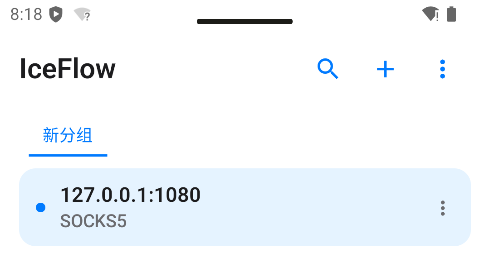
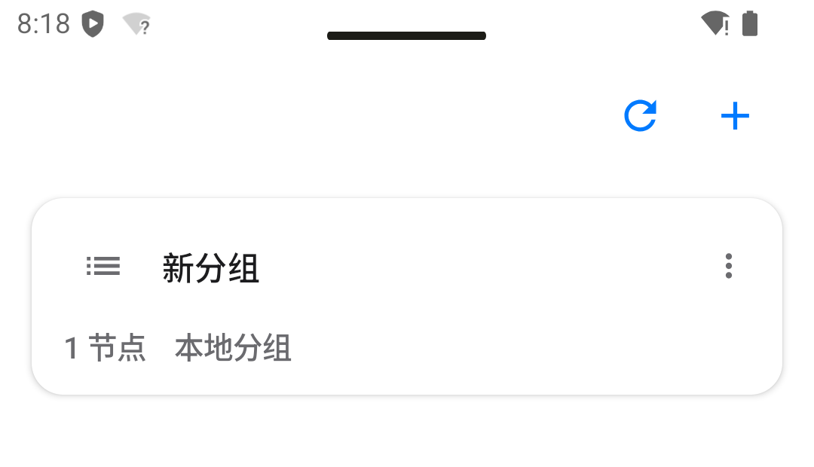
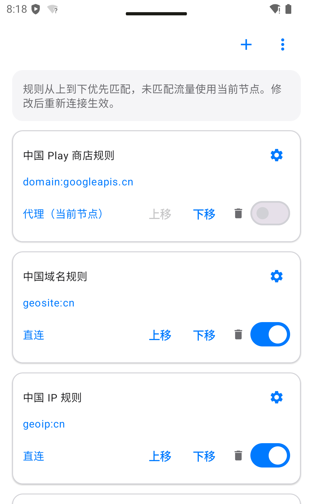
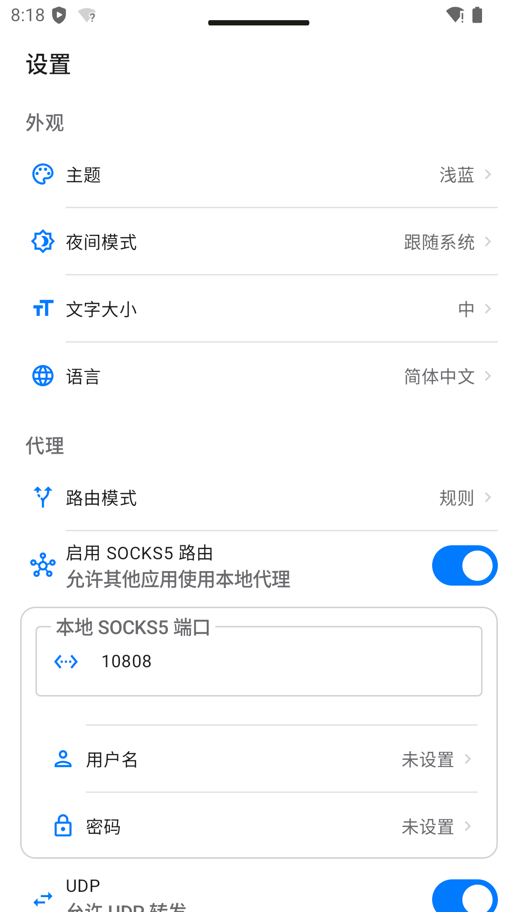
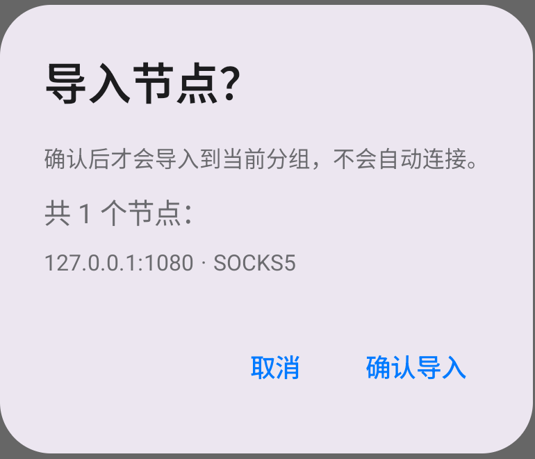
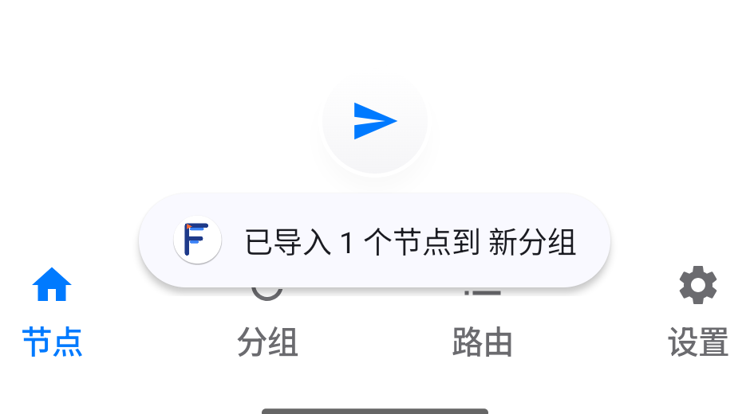
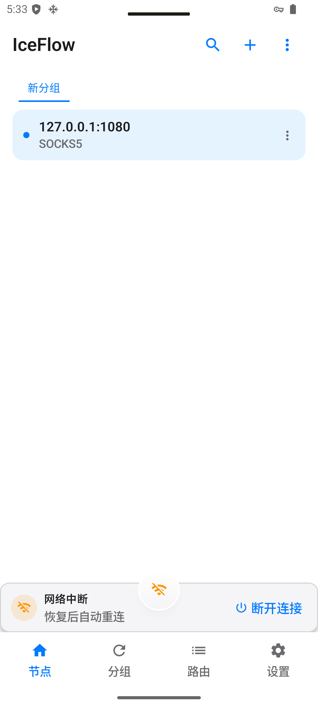
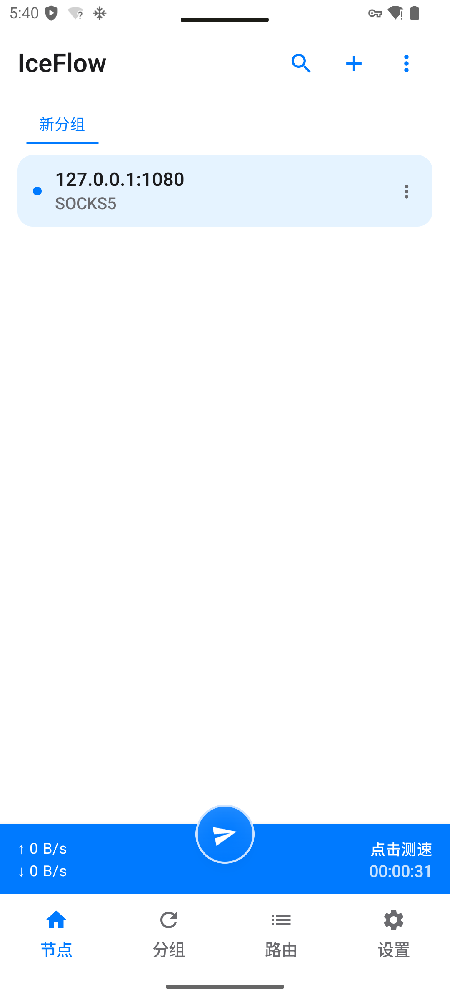

# IceFlow

**现代化 Android 代理客户端 · dual / single 双核心变体**

  
  
  
  

[⬇️ 下载最新版本 v0.1.5.1](https://github.com/HlONGlin/IceFlow/releases/latest) · [English](README.en.md)

---

IceFlow 是一款基于 Jetpack Compose 的 Android 代理客户端，提供节点与订阅管理、规则分流，以及网络中断后的自动恢复体验。dual 和 single 两种变体共享 UI、订阅与路由能力，并提供多种设备架构的 APK。

**当前版本** v0.1.5.1 · **versionCode** 113 · **Android** 8.0 及以上

## 应用模块实机预览

以下画面来自 IceFlow single v0.1.5.1，在 `emulator-5566`（Pixel Tablet、Android 15 / API 35）运行时截取。主展示覆盖节点、分组、路由、设置和导入模块；点击各图可查看完整模拟器截图。

<table>
  <tr>
    <td align="center" width="50%">
      <b>节点管理</b> 
       
      查看节点协议、分组并管理节点。
    </td>
    <td align="center" width="50%">
      <b>分组管理</b> 
       
      集中查看本地分组及其节点数量。
    </td>
  </tr>
  <tr>
    <td align="center" width="50%">
      <b>规则路由</b> 
       
      调整规则顺序、匹配条件和流量出口。
    </td>
    <td align="center" width="50%">
      <b>代理设置</b> 
       
      主题、夜间模式、路由方式及本地代理选项。
    </td>
  </tr>
</table>

### 导入确认

外部节点导入前会先展示内容供确认；确认后写入当前分组，不会自动连接。

<table>
  <tr>
    <td align="center" width="50%"><b>确认导入</b> </td>
    <td align="center" width="50%"><b>导入完成</b> </td>
  </tr>
</table>

> 节点列表中的 `127.0.0.1:1080` 是演示用本地 SOCKS5 条目，不是可用的公共节点；截图仅展示界面模块，不代表代理上游或实际吞吐速度。

查看网络中断与恢复画面

<table>
  <tr>
    <td align="center" width="33%"> 正常连接</td>
    <td align="center" width="33%"> 网络中断时等待恢复</td>
    <td align="center" width="33%"> 网络恢复后自动重连</td>
  </tr>
</table>

## v0.1.5.1

- 网络中断时显示专用等待提示，并隐藏过期的流量和测速信息。
- 网络恢复后自动重新建立连接；等待期间仍可主动断开。
- dual 与 single 变体同步支持网络恢复体验和多语言文案。

查看[完整变更记录](CHANGELOG-v0.1.5.1.md)。

## 下载

从 [GitHub Release v0.1.5.1](https://github.com/HlONGlin/IceFlow/releases/tag/v0.1.5.1) 获取正式签名 APK。安装包沿用原签名，可覆盖安装并保留应用数据。

| 变体 | 核心 | 推荐下载 | 说明 |
| --- | --- | --- | --- |
| **single** | mihomo | [Universal APK](https://github.com/HlONGlin/IceFlow/releases/download/v0.1.5.1/IceFlow-0.1.5.1-single-universal-release.apk) | 适合大多数设备，安装简单 |
| **dual** | xray + mihomo + Rust TUN | [Universal APK](https://github.com/HlONGlin/IceFlow/releases/download/v0.1.5.1/IceFlow-0.1.5.1-dual-universal-release.apk) | 需要双核心能力时选择 |

另有 `arm64-v8a`、`armeabi-v7a`、`x86_64` 架构包。校验文件：[SHA256SUMS.txt](https://github.com/HlONGlin/IceFlow/releases/download/v0.1.5.1/SHA256SUMS.txt) · [构建清单](https://github.com/HlONGlin/IceFlow/releases/download/v0.1.5.1/ARTIFACT_MANIFEST.json)

## 功能一览

| 类别 | 支持能力 |
| --- | --- |
| 协议 | VMess、VLESS（含 Reality）、Trojan、Shadowsocks、Mieru、Hysteria/Hysteria2、TUIC、WireGuard、SSR、HTTP、SOCKS、AnyTLS、Sudoku |
| 导入 | Clash YAML、二维码、HTTPS 订阅、节点分享链接、深链接、配置文件 |
| 路由 | 规则分流、分应用代理、DNS 分流、IPv6、代理链、按规则指定出口 |
| 管理 | 节点分组、订阅更新、批量导入、延迟测试、流量统计、备份与恢复 |
| 体验 | Material Design 3、深色模式、主题切换、响应式布局、断网自动恢复 |

## 核心变体

- **dual**：包含 xray、mihomo 与 Rust TUN 层。
- **single**：仅包含 mihomo。

两个变体共享应用界面、节点管理、订阅和路由功能。依赖特定核心的协议能力会在应用中明确提示。

## 连接结构

~~~mermaid
flowchart TB
    UI["Jetpack Compose UI"] --> VPN["Android VpnService / TUN"]
    VPN --> DUAL["dual · xray + mihomo + Rust TUN"]
    VPN --> SINGLE["single · mihomo"]
    DUAL --> ROUTE["协议处理与路由"]
    SINGLE --> ROUTE
    ROUTE --> SERVER["远端代理服务器"]
~~~

## 快速开始

1. 从 [Release](https://github.com/HlONGlin/IceFlow/releases/latest) 下载适合设备的 APK。
2. 添加节点、导入 HTTPS 订阅，或从其他应用分享节点到 IceFlow。
3. 选择节点并点击连接；首次连接时按 Android 提示授权 VPN。
4. 连接期间若网络中断，等待网络恢复即可，应用会自动重连。

## 深链接与导入

外部导入会先显示确认框；确认前不会写入配置，也不会自动连接。

| 入口 | 示例 |
| --- | --- |
| Clash 订阅 | `clash://install-config?url=https%3A%2F%2Fexample.com%2Fsub` |
| IceFlow 订阅 | `iceflow://install-config?url=https%3A%2F%2Fexample.com%2Fsub&name=My%20Sub` |
| v2rayN 订阅 | `v2rayn://install-sub?url=https%3A%2F%2Fexample.com%2Fsub` |
| sing-box 配置 | `sing-box://import-remote-profile?url=https%3A%2F%2Fexample.com%2Fsub` |
| 节点链接 | `vmess://`、`vless://`、`trojan://`、`ss://`、`ssr://`、`hysteria2://`、`hy2://`、`tuic://`、`wireguard://`、`anytls://`、`mierus://` |
| 配置文件 | 从文件管理器打开 `.yaml`、`.yml`、`.json` 或 `.txt`（最大 4 MiB） |

订阅仅接受 HTTPS；相同地址不会重复添加。完整 `mieru://` Protobuf 链接需要 dual 变体解析。

<b>从源码构建</b>

### 环境要求

- JDK 17
- Android SDK 36 与 NDK
- Rust 和 `cargo-ndk`
- Go 1.26+

### 项目结构

| 目录 | 用途 |
| --- | --- |
| `app/` | Android 应用、Compose 界面与 VPN 服务 |
| `rust-core/` | dual 变体使用的 Rust TUN 转发层 |
| `xray-wrapper/` | dual 变体的 xray gomobile 封装 |
| `mihomo-wrapper/` | single 变体的 mihomo gomobile 封装 |
| `docs/` | 架构、快速开始与设计说明 |

### Release 签名

需要发布签名时，在本地设置以下环境变量；构建脚本要求四项全部提供或全部留空。不要将密钥或密码提交到仓库。

~~~powershell
$env:ICEFLOW_KEYSTORE_PATH="path/to/keystore.jks"
$env:ICEFLOW_KEYSTORE_PASSWORD="keystore_password"
$env:ICEFLOW_KEY_ALIAS="key_alias"
$env:ICEFLOW_KEY_PASSWORD="key_password"
~~~

### Windows

~~~powershell
# Rust TUN 层，仅 dual 使用
rustup target add aarch64-linux-android armv7-linux-androideabi x86_64-linux-android
cargo install cargo-ndk
.\rust-core\build-android.ps1

# xray AAR，仅 dual 使用
.\xray-wrapper\build-aar.ps1

# mihomo AAR，single 使用
.\mihomo-wrapper\build-aar.ps1

# 单元测试与 debug APK
.\gradlew.bat testDualDebugUnitTest testSingleDebugUnitTest assembleDualDebug assembleSingleDebug
~~~

### Linux / macOS

~~~bash
rustup target add aarch64-linux-android armv7-linux-androideabi x86_64-linux-android
cargo install cargo-ndk
./rust-core/build-android.sh
./xray-wrapper/build-aar.sh
./mihomo-wrapper/build-aar.sh
./gradlew testDualDebugUnitTest testSingleDebugUnitTest assembleDualDebug assembleSingleDebug
~~~

> Windows 下建议使用纯英文项目路径；非 ASCII 路径可能导致 Gradle 测试出现 `ClassNotFoundException`。

<b>测试与验证</b>

- app/src/test 与 app/src/testSingle：dual/single JVM 单元测试。
- app/src/androidTest：Android 仪器测试。
- `rust-core/`：Rust 单元测试（`cargo test`）。
- xray-wrapper：Go 单元测试（go test ./...）。

~~~powershell
.\gradlew.bat testDualDebugUnitTest testSingleDebugUnitTest
.\gradlew.bat connectedDualDebugAndroidTest connectedSingleDebugAndroidTest
~~~

v0.1.5.1 已在 `emulator-5566`（Pixel Tablet、Android 15、API 35、x86_64）验证 dual/single 离线启动、single 网络中断等待与自动恢复，以及 dual 主动断开操作。

## 自动更新

应用可在启动后静默检查 GitHub Releases；发现新版本时提醒更新。也可在「设置 → 关于 → IceFlow」手动检查，并关闭自动提醒。

## 项目文档

- [快速开始](docs/IceFlow-QuickStart.md)
- [架构说明](docs/IceFlow-Architecture.md)
- [网络恢复优化](RECONNECTION_OPTIMIZATION.md)
- [测试报告目录](test-reports/README.md)

## 已知限制

- 订阅地址仅支持 HTTPS，订阅内容上限 4 MiB，路由数据库上限 64 MiB。
- 系统级无 VPN 阻断需要在 Android 中开启「始终开启 VPN」和「阻止无 VPN 连接」。
- 完整 `mieru://` Protobuf 链接需要 dual 变体。

**觉得项目有帮助？欢迎点亮 Star ⭐**

